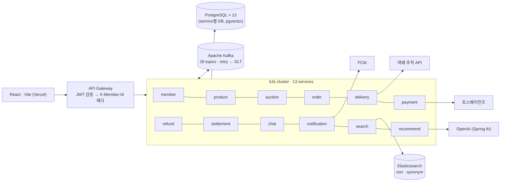

# 🎮 찐막 (JJINMAK)

> 진짜 마지막으로 산다 — 게임 전문 C2C 경매 플랫폼

고전 게임기 · 게임팩 · 한정판 · 주변기기 · 굿즈처럼 **시세가 불분명한 게임 상품의 가격을 입찰로 형성**하는 경매 커머스입니다.
즉시 낙찰 · 경매 · 역경매(네덜란드식) 세 가지 판매 방식을 제공하고, 예치금 지갑과 에스크로로 대금을 보관해 거래를 안전하게 끝냅니다.
백엔드는 Spring Boot 기반 **MSA 13개 서비스 + API Gateway**, 서비스 간 연동은 **Kafka 이벤트**, 검색은 **Elasticsearch**, 추천은 **pgvector 임베딩 + 협업 필터링 + LLM**으로 구현했습니다.

---

## 📋 Table of Contents

- [Demo](#-demo)
- [Project Deliverables](#-project-deliverables)
- [Key Features](#-key-features)
- [System Architecture](#-system-architecture)
- [ERD](#-erd)
- [Tech Stack](#-tech-stack)
- [Repository Structure](#-repository-structure)
- [Getting Started](#-getting-started)
- [Team Members](#-team-members)

---

## 🎥 Demo

👉 [찐막 서비스 바로가기](https://jjinmak.kro.kr) &nbsp;&nbsp; 👉 [찐막 시연 영상 보기](시연_영상_링크)

---

## 📁 Project Deliverables

| 구분 | 파일 | 설명 |
| --- | --- | --- |
| 시연 영상 | [찐막 시연 영상](시연_영상_링크) | 상품 등록 → 경매 → 낙찰 → 결제 → 거래 채팅 → 배송 → 구매확정 → 정산 흐름 시연 |
| 포스터 | [찐막 포스터](docs/찐막_포스터.pdf) | 캡스톤 페스티벌 2026 전시 포스터 (90 × 140cm) |
| 발표 자료 | [찐막 발표 자료](docs/찐막_발표자료.pdf) | 프로젝트 발표용 자료 |
| 결과 보고서 | [찐막 결과 보고서](docs/찐막_결과보고서.pdf) | 프로젝트 최종 결과 보고서 |
| 프론트엔드 | [beadv8_8_AHJB_FE](https://github.com/prgrms-be-adv-devcourse/beadv8_8_AHJB_FE) | React · Vite 프론트엔드 저장소 |

---

## ✨ Key Features

| 영역 | 내용 |
| --- | --- |
| 상품 · 후기 | 게임 특화 상품 정보(기종 · 상태 · 구성품 · 한정판), S3 이미지 업로드, 찜, 실시간 Q&A, 구매확정 후 후기 · 판매자 평점 |
| 경매 | 영국식 경매 · 즉시낙찰 · 네덜란드식 역경매, 종료 5분 전 입찰 시 5분 연장, 낙관적 락 + 재시도로 동시 입찰 처리, 마감 임박 · 상위 입찰 알림 |
| 주문 · 배송 | 낙찰 상품 장바구니 자동 담기, 24시간 내 결제(미이행 시 낙찰 무효), 외부 택배 추적 API · Webhook, 배송 완료 7일 후 자동 구매확정 |
| 결제 · 지갑 | 토스페이먼츠 예치금 충전, 예치금 원스톱 결제(부족분만 PG), 에스크로 홀딩, append-only 원장, 보상 트랜잭션 · 복구 스케줄러 |
| 환불 · 정산 | 구매자 환불 요청 → 판매자 수락/거절, 미발송 시 시스템 자동 환불, 구매확정 기준 정산서 생성, 익월 15일 일괄 지급, 중복 지급 4중 방지 |
| 거래 채팅 | 낙찰 1건마다 구매자 · 판매자 1:1 채팅방 자동 생성, WebSocket(STOMP) 실시간 전송, 참여자 권한 검증 |
| 검색 | Elasticsearch + nori 형태소 분석, 게임 용어 사용자 사전 · 동의어(플스 = 플레이스테이션), 이벤트 기반 인덱스 동기화(CQRS) |
| 추천 | OpenAI 임베딩(1536차원) + pgvector 유사 상품, 상호작용 기반 협업 필터링, 자연어 → 검색 조건 추출(LLM) |
| 회원 · 알림 | JWT + Refresh Token Rotation(HttpOnly 쿠키), 판매자 등록, 경고 누적 제재, FCM 푸시 알림 |

---

## 🏗️ System Architecture



**설계 원칙**

- **서비스 간 통신은 Kafka 이벤트**로만. 동기 HTTP 호출은 결과가 바로 필요한 결제 요청(order → payment) 1건뿐입니다.
- **서비스는 자기 DB만 읽습니다.** 다른 서비스의 데이터는 이벤트로 받아 스냅샷(불변 값) 또는 복제본 테이블(가변 값)로 보관합니다.
- 모든 이벤트는 `eventId` · `occurredAt`을 가지며, 커밋 후(`AFTER_COMMIT`) Kafka로 발행됩니다. 수신은 **멱등**하게 처리하고, 실패는 1 · 2 · 4초 간격 3회 재시도 후 `<topic>-dlt`로 보관합니다.
- 인증은 **Gateway가 JWT를 검증**해 `X-Member-Id`, `X-Member-Roles` 헤더로 전달하고, 각 서비스는 헤더만 신뢰합니다. 브라우저 WebSocket은 `/ws/**` 경로에 한해 `?access_token=`을 허용합니다.
- 배포는 `main` 브랜치 push 시 **변경된 서비스만** 이미지 빌드(태그 = 커밋 SHA) → 매니페스트 치환 → self-hosted 러너가 `kubectl apply` · `rollout status`를 수행합니다.

| 서비스 | 포트 | 역할 |
| --- | --- | --- |
| gateway-service | 8091 | 라우팅, JWT 검증, 헤더 부착 |
| member-service | 8083 | 회원, 인증, 판매자, 경고 · 제재 |
| product-service | 8086 | 상품, 이미지, 찜, Q&A, 후기 |
| auction-service | 8081 | 경매 회차, 입찰, 즉시낙찰, 유찰, 네덜란드식 |
| order-service | 8084 | 장바구니, 주문, 구매확정, 환불 요청 |
| delivery-service | 8082 | 배송 정보, 택배 추적, Webhook |
| payment-service | 8085 | PG 충전, 결제, 지갑, 에스크로, 원장 |
| refund-service | 8087 | 환불 수락 · 거절 · 재처리 |
| settlement-service | 8089 | 정산서 생성, 지급 스케줄러 |
| chat-service | 8093 | 거래 채팅 (REST + WebSocket/STOMP) |
| notification-service | 8088 | 알림 저장, FCM 푸시 |
| search-service | 8092 | Elasticsearch 상품 검색 |
| recommend-service | 8090 | 임베딩 · 협업 필터링 · 자연어 추천 |

---

## 🗂️ ERD

서비스마다 PostgreSQL DB(`<모듈>_db`)를 따로 두고 계정도 분리해, 다른 서비스의 테이블은 권한으로도 접근할 수 없습니다. `*_member`, `*_product` 처럼 이름 앞에 서비스명이 붙은 테이블은 이벤트로 받아 저장한 **복제본**입니다. 스키마는 Flyway `V1__init.sql`이 만들고 Hibernate는 `validate`로 대조만 합니다.

| 서비스 (DB) | 주요 테이블 |
| --- | --- |
| member (`member_db`) | member, address, seller, refresh_token, member_warning, member_sanction |
| product (`product_db`) | product, product_image, product_wish, product_qna, review, reviewable_order, product_member, review_member |
| auction (`auction_db`) | auction, bid, auction_member |
| order (`order_db`) | order_group, orders, cart_item, order_member |
| delivery (`delivery_db`) | delivery, delivery_member |
| payment (`payment_db`) | wallet, wallet_transactions(원장), holding, charge, payment, payment_item, withdrawal, toss_webhook_event, wallet_member |
| refund (`refund_db`) | refund |
| settlement (`settlement_db`) | settlement, settlement_product |
| chat (`chat_db`) | chat_room, chat_message, chat_member, chat_product |
| notification (`notification_db`) | notification |
| recommend (`recommend_db`) | recommend_product(+ embedding vector), recommend_auction, recommend_member, interaction, interaction_log |
| search | DB 없음 — Elasticsearch `product_search` 인덱스만 사용 |

> 전체 ERD 이미지: [docs/erd.png](docs/erd.png)

---

## 🛠️ Tech Stack

| 구분 | 기술 |
| --- | --- |
| Backend | Java 25, Spring Boot 4.1, Spring Data JPA, Spring Security, Spring WebSocket (STOMP), Spring Cloud Gateway, Spring AI, Flyway, springdoc-openapi |
| Database | PostgreSQL (pgvector), H2 (테스트) |
| Messaging | Apache Kafka 4.3 (KRaft) — 토픽 28개, 재시도 · DLT 공통 모듈 |
| Search / AI | Elasticsearch 9 (nori, synonym_graph), OpenAI text-embedding-3-large, OpenAI Chat (자연어 조건 추출) |
| External | 토스페이먼츠, Firebase Cloud Messaging, AWS S3, 택배 추적 API |
| Infra / CI·CD | k3s, Docker, GitHub Actions (변경 서비스 감지 → GHCR → kubectl rollout), Nginx |
| Frontend | React, TypeScript, Vite, @stomp/stompjs, Vercel |
| Build / Tools | Gradle (Kotlin DSL, 멀티모듈), Bucket4j, Lombok, Notion, Slack, Discord |

---

## 📂 Repository Structure

```
.
├── src/                     # 초기 모놀리스 (분리 완료 후 유지, 수정하지 않음)
├── libs/
│   ├── common/              # 예외 · 응답 템플릿 · 헤더 인증 · JPA Base 엔티티
│   ├── common-kafka/        # Kafka 재시도 · DLT 공통 설정
│   └── event-contracts/     # 서비스 간 이벤트 계약 (순수 record · enum)
├── services/
│   ├── gateway-service/
│   ├── member-service/ product-service/ auction-service/ order-service/
│   ├── delivery-service/ payment-service/ refund-service/ settlement-service/
│   └── chat-service/ notification-service/ search-service/ recommend-service/
├── k8s/
│   ├── app/                 # 서비스별 ConfigMap · Deployment · Service 매니페스트
│   └── infra/               # PostgreSQL · Kafka · Elasticsearch
├── .github/workflows/       # ci.yaml, msa-cd.yaml, msa-image-push.yaml
├── docker-compose.local.yaml
└── docs/                    # 포스터 · 발표 자료 · 결과 보고서
```

---

## 🚀 Getting Started

**1. 로컬 인프라 (PostgreSQL · Kafka · Elasticsearch)**

```bash
docker compose -f docker-compose.local.yaml up -d
```

**2. 서비스별 DB 생성**

```bash
docker exec pgvector-db psql -U postgres -c "CREATE DATABASE member_db;"
# auction_db, order_db, payment_db, refund_db, settlement_db, chat_db ... 같은 방식
```

**3. 서비스 실행** (`local` 프로필 필수, Flyway가 스키마를 생성)

```bash
./gradlew :services:member-service:bootRun --args="--spring.profiles.active=local"
./gradlew :services:gateway-service:bootRun --args="--spring.profiles.active=local"
./gradlew :services:auction-service:bootRun --args="--spring.profiles.active=local"
```

**4. 확인**

```bash
# Gateway 없이 서비스 직접 호출 (헤더 직접 주입)
curl -H "X-Member-Id: 1" -H "X-Member-Roles: ROLE_BUYER" http://localhost:8089/api/v1/settlements
# Gateway 경유: 8091로 로그인 후 Bearer 토큰으로 호출
```

Kafka UI: http://localhost:8989 · Swagger: 각 서비스 `/swagger-ui.html`

---
